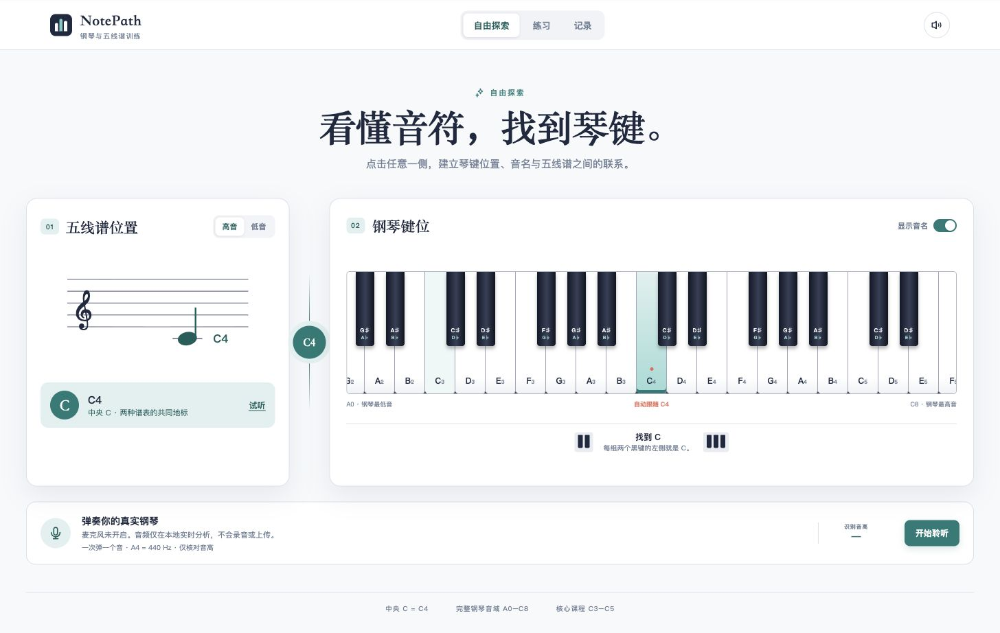
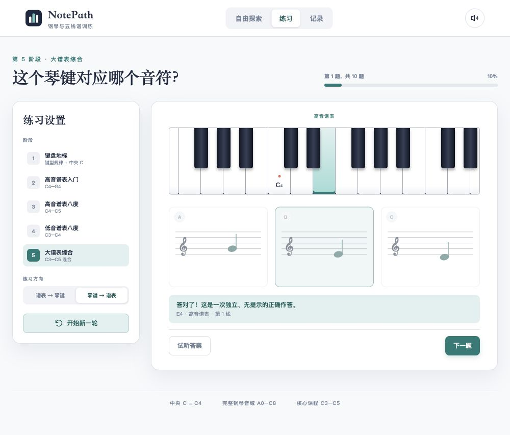
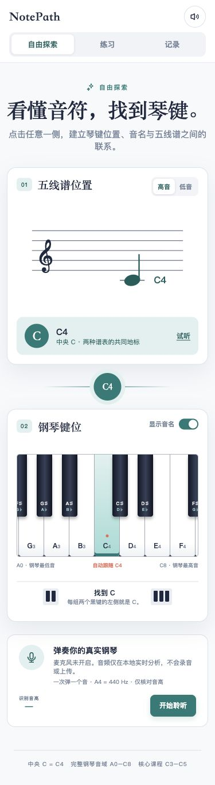

# NotePath · 钢琴与五线谱训练

从中央 C 开始，把**谱面位置、音名与八度、琴键位置**联系起来。

NotePath 是一个面向钢琴入门的交互式识谱 Demo。点击虚拟琴键即可探索，也可以通过麦克风弹奏单音进行练习。

**[在线体验 →](https://sylviacc1001.github.io/notepath-piano/)** · 无需注册 · 支持电脑和触屏 · GitHub Pages 免费托管



## 可以做什么

| 功能 | 说明 |
| --- | --- |
| 自由探索 | A0–C8 完整 88 键；点击琴键或谱面位置，联动显示音名、八度和对应位置，并可试听。 |
| 谱表定位 | 切换高音、低音谱号；中央 C 统一记为 C4，极端音区使用八度记号，减少加线。 |
| 双向练习 | 看谱找琴键，或看标记的琴键，从三个谱面选项中找出对应音符。 |
| 提示与纠错 | 分级提示、错误反馈、重试和错题重练；区分音名错误与八度混淆。 |
| 练习记录 | 每轮 10 题，不限时；保存最近 30 轮，统计首次无提示答对和使用提示的题数。 |
| 麦克风识音 | 在自由探索中识别单音，在“谱表 → 琴键”中用真实钢琴作答；可暂停、继续和结束。 |
| 音区跟随 | 完整键盘在容器内横向滚动，并跟随探索中的当前音符；支持窄屏查看。 |

## 怎么开始

1. 打开[在线 Demo](https://sylviacc1001.github.io/notepath-piano/)，在“自由探索”里从中央 C4 开始，观察琴键和谱面的对应。
2. 切换高音或低音谱号，尝试相邻音和不同八度；按需关闭音名或试听。
3. 进入“练习”，选择阶段和方向，完成一轮 10 题。答错后可以重试，也可以使用提示。
4. 完成后查看结果或只练错题，在“记录”中回看已完成的练习。

只有**首次作答正确且未使用提示**的题目才计入首次答对；纠正答案、使用提示或直接查看答案都不会计入这一指标。

### 五个练习阶段

| 阶段 | 内容 |
| --- | --- |
| 1 · 键盘地标 | 黑键分组规律与中央 C4 |
| 2 · 高音谱表入门 | C4–G4 |
| 3 · 高音谱表八度 | C4–C5 |
| 4 · 低音谱表八度 | C3–C4 |
| 5 · 大谱表综合 | C3–C5，混合高音与低音谱号 |

探索可以使用完整 88 键，课程题目以 C3–C5 的自然音为主；黑键在探索中显示升、降音名称，尚未加入课程出题范围。



### 手机与窄屏

琴键保持可点击的尺寸，在键盘区域内横向滑动查看音区。

<details>
<summary>查看移动端截图</summary>



</details>

截图来自实际运行的 Demo；练习截图展示的是测试操作，不代表用户的真实学习成绩。

## 用真实钢琴练习

在“自由探索”或“谱表 → 琴键”练习中点击“开始聆听”，允许浏览器访问麦克风后，一次弹一个清晰、稳定的音。

- 以 A4 = 440 Hz 换算音名；探索识别范围为 A0–C8，练习按所选阶段的范围判断。
- 同一个持续音只计一次；重新弹相同音时先松开琴键，让声音有可检测的释放间隔。
- 过小、过于不稳定或超出阶段的输入不计分；阶段内稳定的错误音会记录为错答。
- 监听时普通虚拟琴键点击不发声；主动试听会隔离检测，避免示范音被当作作答。
- 结束监听会释放麦克风；切到“琴键 → 谱表”时暂停识音，该方向使用谱面选项作答。

音频仅在当前浏览器中实时分析，**不保存或上传录音**。拒绝授权时，仍可使用虚拟键盘。

当前仅用于单音识别，不支持和弦作答，也不能保证过滤所有多音输入。真实钢琴、电钢琴音色、房间噪声与不同麦克风的准确率和延迟仍需实测，尤其是极低音和极高音。

## 本地运行

本仓库直接包含可运行的静态文件，无需安装前端依赖或构建工具。安装 Python 3 后执行：

```bash
git clone https://github.com/SylviaCC1001/notepath-piano.git
cd notepath-piano
python3 -m http.server 8765 --bind 127.0.0.1
```

然后打开 **http://127.0.0.1:8765/**。

请通过 localhost 或 HTTPS 使用麦克风。直接双击 `index.html` 不适用于 JavaScript 模块加载及麦克风访问。浏览器声音需要用户操作后启用，当前音色为基础合成音。

## 实现与部署

- **界面与交互**：原生 HTML、CSS、JavaScript ES Modules。
- **声音与识音**：Web Audio API、YIN 单音音高检测和持续音门控。
- **记录**：浏览器 `localStorage`，无账号、后端或云同步。
- **部署**：GitHub Pages，从 `main` 分支根目录发布，启用 HTTPS；关闭本机不影响在线使用。

```text
.
├── index.html             # 页面入口
├── styles.css             # 样式与响应式布局
├── app.mjs                # 页面、练习、声音和麦克风交互
├── music.mjs              # 音名、谱面位置、题目与计分
├── pitch.mjs              # YIN 检测与持续音门控
├── favicon.svg
├── docs/screenshots/      # README 截图
└── .nojekyll              # Pages 直接发布静态文件
```

练习记录仅保存在当前站点、当前浏览器中，不会在设备间同步；localhost 与公网地址的记录也相互独立。清除浏览器站点数据会移除这些记录。

## 验证与范围

开发版本已通过 7 组自动测试，覆盖谱面锚点、计分规则、选项范围、44.1 / 48 kHz 下全部 88 个音的合成信号识别、噪声拒绝、延音门控与八度记号。另已检查桌面及 320 / 375 像素窄屏交互，并用受控 MediaStream 验证识音流程。

本发布仓库只保留静态运行文件和使用文档，不包含开发环境的测试脚本。合成信号验证不等同于真实琴声效果已经验证。

本 Demo 帮助建立琴键与谱面的对应，不评估指法、手型、力度或节奏，也不以虚拟键盘成绩证明实体琴演奏能力。

界面基于 [Piano Learn / NotePath 的 Figma Make 设计](https://www.figma.com/make/UAA41X48CsGMmjMSSnNtxn/Piano-Learn) 实现。
